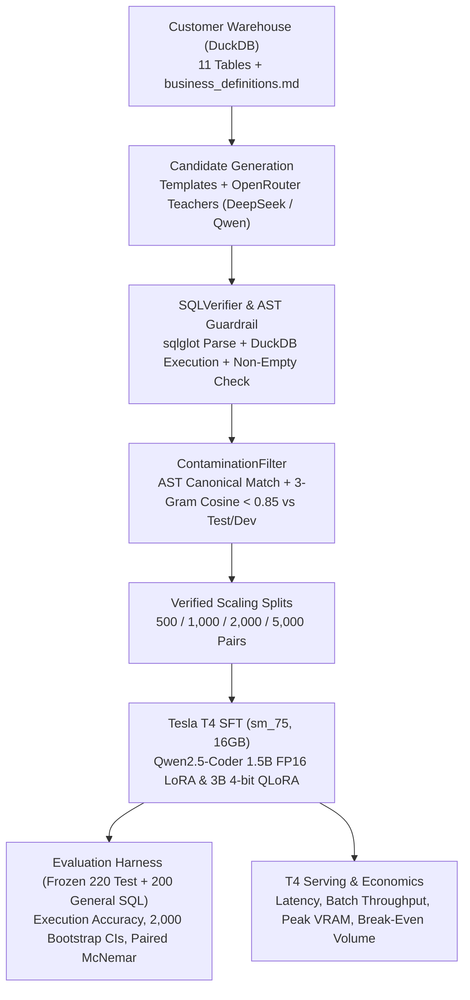

# schema-tuned-sql: Execution-Verified LoRA/QLoRA Text-to-SQL on NVIDIA T4 GPUs

**Adapting small open code models (`Qwen2.5-Coder-1.5B` and `3B`) to a private B2B SaaS DuckDB warehouse using execution-verified distillation, AST read-only guardrails, and Turing (`sm_75`) FP16/QLoRA recipes.**

[](LICENSE)
[](pyproject.toml)
[-76B900.svg)](notebooks/t4_runner.ipynb)

---

## Headline Question

> *Can a 1.5B–3B open model, fine-tuned on 5,000 execution-verified examples for one customer schema, match a larger API model on that schema at a fraction of the cost per query, and what does it lose on general SQL?*

Forward-deployed AI engineers frequently face a customer whose analytical questions depend on bespoke semantic definitions (*Weekly Active User*, *Activated Account*, *Net Revenue Retention*, *Urgent Ticket SLA*) that generic models hallucinate on, and whose security posture forbids sending table schemas or customer queries to external frontier APIs. This repository implements the complete forward-deployed loop:
1. **Customer Semantic Warehouse (`warehouse/`):** 11 normalized B2B SaaS tables in DuckDB seeded deterministically (`seed=42`) paired with authoritative metric rules in [`warehouse/business_definitions.md`](warehouse/business_definitions.md).
2. **Frozen Evaluation Suite (`data/`):** 220 hand-verified test items (`200` answerable across Easy/Medium/Hard + `20` unanswerable refusal queries; SHA-256 `84a938a29aa438c1c901f4dfadbfe13af01451ef2c55177010493133f90b6b5c`), `100` dev items (SHA-256 `2e5064b46fe8001332aff4b21398fa86d134fa15d26c1113606603c57e44925f`), and a `200`-item cross-domain general-SQL holdout (`51a6f67d1e0a...`) to measure catastrophic forgetting.
3. **Execution-Verified Distillation (`src/datagen/`):** Candidate SQL queries are parsed via `sqlglot` (DuckDB dialect), checked against an AST read-only guardrail (`ReadOnlySQLGuardrail`), executed in DuckDB to confirm non-empty results, and filtered for test/dev contamination ($\text{sim} < 0.85$).
4. **T4-Safe Fine-Tuning (`src/train/`):** `Qwen2.5-Coder-1.5B-Instruct` (FP16 LoRA) and `Qwen2.5-Coder-3B-Instruct` (4-bit NF4 QLoRA) configured for NVIDIA Tesla T4 (`sm_75`, 16 GB VRAM: no `bf16`, no FlashAttention-2, PyTorch `sdpa`, `paged_adamw_8bit`, FP32 master adapter weights, and completion-only loss masking).
5. **Statistical Rigor & Serving Economics (`src/eval/`, `src/serve/`):** Execution Accuracy (EX) with 2,000-resample bootstrap 95% confidence intervals, paired McNemar tests, and an API-vs-T4 break-even cost model.

---

## Engineering Notes & Systems Design

1. **DuckDB requires two-layer sandboxing before executing LLM-generated SQL:** Standard SQLite/Postgres read-only flags are insufficient in DuckDB because `SELECT * FROM read_csv('/etc/passwd')` is syntactically a `SELECT` statement where `sqlglot` parses `read_csv(...)` as a table expression rather than a top-level command. Combining DuckDB's `enable_external_access=false` + `SET lock_configuration=true` with `sqlglot` AST inspection (`ReadOnlySQLGuardrail`) blocks table functions, file paths, multi-statement injections, and schema-qualified system probes before execution.
2. **Completion-only loss masking is mandatory when prompts carry full DDL schemas:** Including 11 table DDLs and business metric definitions in the prompt creates a roughly 10:1 prompt-to-completion token ratio. Without `DataCollatorForCompletionOnlyLM` (`loss_on: completion_only`), >90% of cross-entropy gradient updates optimize copying static DDL text rather than SQL syntax and join conditions.
3. **Tesla T4 (`sm_75`) requires explicit FP16 + FP32-adapter hybrid precision:** Turing GPUs lack native `bfloat16` tensor cores and Ampere `flash_attention_2` kernels. Training `Qwen2.5-Coder` in pure FP16 risks gradient underflow and `NaN` loss spikes; upcasting trainable LoRA adapter tensors (`requires_grad=True`) to `torch.float32` while keeping frozen base weights in `float16` / 4-bit `nf4` with `attn_implementation="sdpa"` and `max_grad_norm=1.0` keeps T4 training numerically stable within 16 GB VRAM.
4. **Empirical Teacher Distillation & T4 Serving Telemetry:** `N/A` — Pending live OpenRouter API execution (`--mode live`) and physical NVIDIA Tesla T4 execution ([`notebooks/t4_runner.ipynb`](notebooks/t4_runner.ipynb)).

---

## Architecture



---

## Benchmark Results (Pending OpenRouter & NVIDIA Tesla T4 Execution)

> [!IMPORTANT]
> **Provenance & Mode Disclosure (Anti-Slop Policy):**
> Following the strict separation enforced in [`rag-eval-harness`](https://github.com/adityavsb/rag-eval-harness), offline or dry-run modes never produce numbers shown as model or hardware results (`is_model_evidence: false`, `is_hardware_telemetry: false`). All tables below that depend on live OpenRouter API calls or physical NVIDIA Tesla T4 GPUs remain **`N/A`** until executed via `--mode live` and [`notebooks/t4_runner.ipynb`](notebooks/t4_runner.ipynb).

### 1. System Evaluation on Frozen `test_gold.jsonl` ($n=220$) & `general_sql_holdout.jsonl` ($n=200$)

| ID | System | Execution Accuracy (EX %) | 95% Bootstrap CI ($B=2000$) | Valid SQL % | Refusal Acc % ($n=20$) | McNemar $p$ vs `B2` | General-SQL Holdout EX % ($n=200$) |
| :--- | :--- | :---: | :---: | :---: | :---: | :---: | :---: |
| **B0** | `Qwen2.5-Coder-3B` Zero-Shot | N/A | N/A | N/A | N/A | N/A | N/A |
| **B1** | `Qwen2.5-Coder-3B` Few-Shot ($k=5$) | N/A | N/A | N/A | N/A | N/A | N/A |
| **B2** | `Qwen2.5-Coder-3B` + Schema-RAG | N/A | N/A | N/A | N/A | — | N/A |
| **T1** | Teacher API (`deepseek/deepseek-chat`) | N/A | N/A | N/A | N/A | N/A | N/A |
| **T2** | Peer API (`qwen/qwen-2.5-coder-32b-instruct`) | N/A | N/A | N/A | N/A | N/A | N/A |
| **S1** | Fine-Tuned `Qwen2.5-Coder-1.5B` (FP16 LoRA) | N/A | N/A | N/A | N/A | N/A | N/A |
| **S2** | Fine-Tuned `Qwen2.5-Coder-3B` (4-bit QLoRA) | N/A | N/A | N/A | N/A | N/A | N/A |
| **S3** | Fine-Tuned `Qwen2.5-Coder-7B` (4-bit QLoRA, Stretch) | N/A | N/A | N/A | N/A | N/A | N/A |
| **S4** | Fine-Tuned `Qwen2.5-Coder-3B` + Schema-RAG | N/A | N/A | N/A | N/A | N/A | N/A |

---

### 2. Execution-Verified Distillation Acceptance Rates

Source: [`results/distillation_manifest.json`](results/distillation_manifest.json) (`status: pending_openrouter_run`).

| Difficulty Bucket | Candidates Attempted | Execution Verified & Clean | Acceptance Rate | Rejected (Execution / Guardrail) | Rejected (Test/Dev Contamination) |
| :--- | :---: | :---: | :---: | :---: | :---: |
| **Easy** (Single-table filter/agg) | N/A | N/A | N/A | N/A | N/A |
| **Medium** (2–3 table joins, `GROUP BY`, `HAVING`) | N/A | N/A | N/A | N/A | N/A |
| **Hard** (Business definitions, CTEs, windows, refusals) | N/A | N/A | N/A | N/A | N/A |
| **Total** | N/A | N/A | N/A | N/A | N/A |

---

### 3. T4 SFT Configuration Matrix

Source: [`results/t4_sft_dryrun_manifest.json`](results/t4_sft_dryrun_manifest.json) (`status: pending_t4_gpu_run`).

| Config ID | Base Checkpoint | Precision / Quantization | Attention | LoRA Rank ($r / \alpha$) | Verified Train Examples | Peak VRAM (GB) | Train Time (min) | Status |
| :--- | :--- | :--- | :---: | :---: | :---: | :---: | :---: | :---: |
| `sft-qwen15b-lora` (`S1`) | `Qwen/Qwen2.5-Coder-1.5B-Instruct` | FP16 LoRA (FP32 master adapters) | `sdpa` | `16 / 32` | N/A | N/A | N/A | `pending_t4_gpu_run` |
| `sft-qwen3b-qlora` (`S2`) | `Qwen/Qwen2.5-Coder-3B-Instruct` | 4-bit NF4 QLoRA (double quant, FP16 compute) | `sdpa` | `16 / 32` | N/A | N/A | N/A | `pending_t4_gpu_run` |
| `sft-qwen7b-qlora` (`S3`) | `Qwen/Qwen2.5-Coder-7B-Instruct` | 4-bit NF4 QLoRA (max seq 1024) | `sdpa` | `16 / 32` | N/A | N/A | N/A | `pending_t4_gpu_run` |

---

### 4. Serving Latency, Throughput & Cost Break-Even (T4 vs. OpenRouter Teacher API)

Source: [`results/serving_cost_analysis.json`](results/serving_cost_analysis.json) (`status: pending_t4_gpu_run`).

| Parameter / Metric | Value | Notes |
| :--- | :---: | :--- |
| **Comparison Teacher API** | `deepseek/deepseek-chat` | Pinned in `configs/serve.yaml` |
| **Average Query Footprint** | N/A | Pending live evaluation token telemetry |
| **Teacher API Cost per 1,000 Queries** | N/A | Pending live evaluation token telemetry |
| **T4 Batch-1 Latency (`p50` / `p95` ms)** | N/A | Pending Tesla T4 benchmark (`--mode cuda_live`) |
| **T4 Saturated Throughput (Batch 8 QPS)** | N/A | Pending Tesla T4 benchmark (`--mode cuda_live`) |
| **T4 Peak Serving VRAM (GB)** | N/A | Pending Tesla T4 benchmark (`--mode cuda_live`) |
| **T4 Saturated Cost per 1,000 Queries** | N/A | Pending Tesla T4 benchmark (`--mode cuda_live`) |
| **Dedicated 24/7 Break-Even Volume** | N/A | Pending Tesla T4 benchmark (`--mode cuda_live`) |

---

### 5. Pre-Registered Targets vs. Current Status

| Target | Goal | Current Status |
| :--- | :--- | :--- |
| **M1: Warehouse & Frozen Splits** | 11-table DuckDB warehouse + `220` frozen test (`84a938a29aa4...`) + `100` dev (`2e5064b46fe8...`) | **Met** (100% execution verified in DuckDB) |
| **M2: Provider & Guardrails** | OpenRouter provider, SHA-256 disk cache, hard `max_usd: 15.0` cap, BM25 Schema-RAG | **Met** (Verified in `tests/test_provider_budget.py`) |
| **M3: Distillation Pipeline & Holdout** | Execution-verified distillation pipeline + `200` general-SQL holdout (`51a6f67d1e0a...`) | **Code Verified / Data Pending OpenRouter Run** |
| **M4–M5: Live T4 Training, Eval & Serving** | Train `S1`/`S2` on T4 (`notebooks/t4_runner.ipynb`) and run `--mode live` evaluation | **Pending OpenRouter API Key & Tesla T4 GPU** |

---

## Hardware Friction & Limitations

1. **Turing (`sm_75`) Hardware Ceiling:** The NVIDIA Tesla T4 lacks `bfloat16` support and Ampere `FlashAttention-2` kernels. All training and serving configs enforce `fp16` with `sdpa` and `paged_adamw_8bit`. Sequence lengths above `2048` risk OOM on 16 GB VRAM for 3B/7B models.
2. **Single-Warehouse Specialization Scope:** The distillation pipeline optimizes for a single customer's 11-table schema and semantic layer (`MetricPulse`). General-SQL retention must always be checked against `data/general_sql_holdout.jsonl`.
3. **Synthetic Distribution Caveats:** While `warehouse/generate_data.py` models diurnal activity, plan upgrades, churn, and SLA breaches, synthetic queries do not capture messy legacy column naming (`col_tmp_v2_final`) found in older enterprise warehouses.

---

## Quickstart & Reproducibility

```bash
# 1. Install dependencies (editable mode with dev tools)
make install

# 2. Build and deterministically seed the DuckDB warehouse (seed=42)
make warehouse

# 3. Run the full offline CPU test suite (warehouse, AST guardrail, budget cap, contamination, provenance)
make test

# 4. Run ruff linter and formatting checks
make lint
```

To execute live OpenRouter teacher distillation or API baseline evaluation:
1. Copy `.env.example` to `.env` (gitignored) and set `OPENROUTER_API_KEY=sk-or-...`.
2. Run distillation: `python -m src.datagen.generator --config configs/data_gen.yaml --mode live`
3. Run live evaluation: `python -m src.eval.runner --config configs/eval.yaml --mode live --out results/live_eval_summary.json`
4. Run T4 training & serving benchmarks via [`notebooks/t4_runner.ipynb`](notebooks/t4_runner.ipynb).

---

## Repository Layout

```
schema-tuned-sql/
├── README.md                     # Technical report, architecture, and evaluation tables
├── plan.md                       # Pre-registered engineering targets and system matrix
├── Makefile                      # Atomic developer targets (install, lint, test, warehouse, data, eval)
├── pyproject.toml                # Pinned package dependencies and ruff/pytest config
├── .env.example                  # Template for OPENROUTER_API_KEY (never committed with secrets)
├── configs/                      # Pydantic-validated YAML configurations
│   ├── data_gen.yaml             # Teacher models, $15 budget cap, contamination threshold
│   ├── sft_qwen15b_lora.yaml     # T4 FP16 LoRA recipe for Qwen2.5-Coder-1.5B
│   ├── sft_qwen3b_qlora.yaml     # T4 4-bit NF4 QLoRA recipe for Qwen2.5-Coder-3B
│   ├── sft_qwen7b_qlora.yaml     # Stretch 7B QLoRA recipe (seq 1024)
│   ├── eval.yaml                 # Systems B0-B2, T1-T2, S1-S4, bootstrap B=2000, McNemar pairs
│   └── serve.yaml                # T4 serving batch sizes and cost model assumptions
├── warehouse/
│   ├── schema.sql                # 11-table DuckDB DDL for MetricPulse B2B SaaS
│   ├── generate_data.py          # Deterministic synthetic data generator (seed=42)
│   └── business_definitions.md   # Customer semantic layer (WAU, Activation, MRR, ARR, SLAs)
├── data/
│   ├── README.md                 # Dataset card with split checksums and contamination rules
│   ├── test_gold.jsonl           # FROZEN 220-item hand-verified test suite (200 SQL + 20 refusal)
│   ├── dev.jsonl                 # 100-item development split
│   ├── general_sql_holdout.jsonl # 200-item cross-domain holdout (4 schemas) for forgetting checks
│   └── train/manifest.json       # Distillation manifest (populated on live OpenRouter run)
├── src/
│   ├── llm/                      # OpenRouter LiteLLM provider, SHA-256 disk cache, BudgetTracker
│   ├── datagen/                  # Templates, SQLVerifier, ContaminationFilter, distillation runner
│   ├── train/                    # T4-safe SFT trainer, completion-only collator, DPO/ORPO pair builder
│   ├── eval/                     # DuckDB multiset execution comparator, bootstrap/McNemar, Schema-RAG
│   ├── serve/                    # T4 latency/throughput benchmark and break-even economics
│   └── utils/                    # Pydantic config loader, AST ReadOnlySQLGuardrail, MLflow tracker
├── notebooks/
│   └── t4_runner.ipynb           # Self-contained Kaggle/Colab Tesla T4 execution notebook
├── results/                      # Committed JSON manifests backing README status and live runs
├── docs/decisions.md             # Architecture Decision Records (ADRs 001-004)
└── tests/                        # CPU-only unit & provenance test suite (no API keys required)
```

---

## References & Disclaimers

- **Literature:** Hu et al. (2021), *LoRA: Low-Rank Adaptation of Large Language Models*; Dettmers et al. (2023), *QLoRA: Efficient Finetuning of Quantized LLMs*; Yu et al. (2018), *Spider: A Large-Scale Human-Labeled Dataset for Complex and Cross-Domain Semantic Parsing and Text-to-SQL*; Rafailov et al. (2023), *Direct Preference Optimization*.
- **Architecture Decision Records:** [`docs/decisions.md`](docs/decisions.md).
- **Disclaimer:** All schemas, company names ("MetricPulse"), user emails, and product events in this repository are 100% synthetic. Not affiliated with Qwen, DeepSeek, OpenRouter, or any employer.
