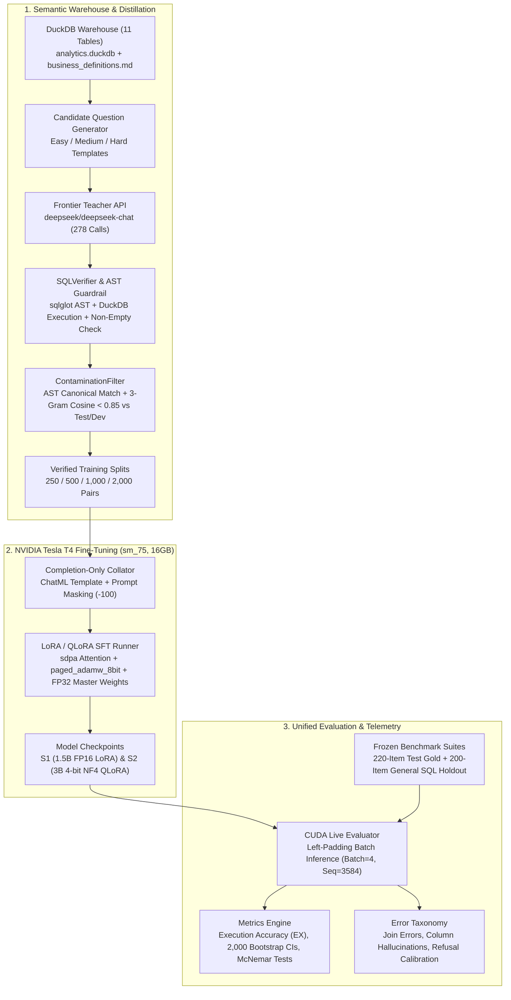

# schema-tuned-sql: Adapting Open Code Models to Private Enterprise Warehouses

**Domain-specific Text-to-SQL on NVIDIA Tesla T4 GPUs via execution-verified distillation, Turing sm_75 FP16/QLoRA recipes, and AST read-only guardrails.**

[](LICENSE)
[](pyproject.toml)
[-76B900.svg)](notebooks/t4_runner.ipynb)
[](tests/)

Compare zero-shot open baselines, **BM25 Schema + Definition RAG**, and **NVIDIA Tesla T4 fine-tuned students** against frontier teacher APIs on a realistic B2B SaaS DuckDB warehouse. Every evaluation metric uses rigorous statistical grounding: **Execution Accuracy (EX)** across a frozen 220-query test set, **2,000-resample bootstrap 95% confidence intervals**, paired **McNemar significance tests**, and a **200-query cross-domain holdout** to measure catastrophic forgetting. Switch between frontier API teachers ([OpenRouter](https://openrouter.ai/): DeepSeek-V3, Qwen-2.5-Coder-32B) and local GPU students (`Qwen2.5-Coder-1.5B` FP16 LoRA, `Qwen2.5-Coder-3B` 4-bit NF4 QLoRA) running in physical hardware isolation. All offline checks run without external credentials; empirical hardware runs are documented below.

**On this page:** [The Business Question](#the-business-question) · [The Teacher-Student Paradigm](#the-teacher-student-distillation-paradigm-how-it-works) · [What I Learned](#what-i-learned-systems-reality-vs-theoretical-claims) · [Core Hypotheses & Outcomes](#core-hypotheses--empirical-outcomes) · [Architecture](#architecture) · [Benchmark Results](#benchmark-results-frontier-teachers-vs-tesla-t4-students) · [Serving Economics](#serving-latency-throughput--break-even-economics) · [Proposed Next Directions](#proposed-next-engineering-directions-a-b-c) · [Quickstart](#quickstart--reproducibility) · [Repo Layout](#repository-layout)

---

## The Business Question

> *Can a 1.5B–3B open code model, fine-tuned on 2,000 execution-verified examples for one customer schema, match a larger API model on that schema at a fraction of the operating cost, and what does it lose on general SQL?*

In enterprise analytics, engineering teams face two critical constraints:
1. **Strict Data Privacy & Air-Gapped Deployments:** Enterprises frequently operate under regulatory frameworks (HIPAA, SOC 2, GDPR) that strictly prohibit transmitting table DDLs, metadata, or customer questions to external frontier API endpoints.
2. **Proprietary Semantic Layers:** Generic foundation models fail on bespoke enterprise definitions (*Weekly Active User*, *Activated Account*, *Net Revenue Retention*, *Urgent Ticket SLA*). Without domain grounding, foundation models hallucinate non-existent columns, invent invalid join paths, or emit syntactically valid SQL that computes the wrong business logic.

This repository implements the complete engineering loop:
- **Customer Semantic Warehouse (`warehouse/`):** 11 normalized B2B SaaS tables in DuckDB seeded deterministically (`seed=42`) paired with authoritative business metric rules in [`warehouse/business_definitions.md`](warehouse/business_definitions.md).
- **Frozen Benchmark Suite (`data/`):** 220 hand-verified test items (`200` answerable across Easy/Medium/Hard + `20` unanswerable refusal queries), `100` dev items, and a `200`-item cross-domain general-SQL holdout across 4 external schemas to quantify catastrophic forgetting (cryptographic checksums tracked in [`data/README.md`](data/README.md)).
- **Execution-Verified Distillation (`src/datagen/`):** 2,000 clean pairs distilled from `deepseek/deepseek-chat` across 4 scaling splits (`250`, `500`, `1,000`, `2,000`), verified via AST inspection (`ReadOnlySQLGuardrail`), executed in DuckDB to guarantee non-empty result sets, and quarantined against test/dev contamination.
- **T4-Safe Fine-Tuning Recipes (`src/train/`):** `Qwen2.5-Coder-1.5B` (FP16 LoRA) and `Qwen2.5-Coder-3B` (4-bit NF4 QLoRA) fine-tuned on a single NVIDIA Tesla T4 (`sm_75`, 16 GB VRAM) using PyTorch `sdpa`, `paged_adamw_8bit`, completion-only loss masking, and FP32 master adapter weights.

---

### The Teacher-Student Distillation Paradigm: How It Works

If you are new to LLM distillation for domain tasks, the teacher-student setup works as follows:

1. **The Frontier Teacher (`deepseek/deepseek-chat`):** A massive 671-billion parameter Mixture-of-Experts (MoE) model hosted in the cloud. It has broad general intelligence and writes fluent SQL, but sending private company schemas or queries to a cloud API raises data sovereignty concerns, has variable network latency, and incurs ongoing token costs.
2. **The Local Student (`Qwen2.5-Coder-1.5B` & `3B`):** Compact open-weights code models small enough to run entirely air-gapped on standard enterprise hardware (a single NVIDIA Tesla T4 GPU). Out of the box, however, small models suffer from high hallucination rates and struggle with multi-table joins.
3. **The Distillation & Fine-Tuning Loop:** Instead of hiring domain experts to manually author thousands of SQL queries for a company's database, we use the frontier Teacher model to generate candidate SQL queries across hundreds of synthetic analytical questions. Each generated query is immediately parsed through an AST guardrail and executed against a live DuckDB instance. If a query fails to compile, produces a `BinderException`, or returns an empty result set, it is rejected. Only the clean, execution-verified query pairs (2,000 items) are retained.
4. **The Goal:** By fine-tuning the small Student model on these verified pairs, the Student internalizes the specific schema, foreign keys, and business definitions. The objective is to achieve teacher-grade accuracy on that private schema while running self-hosted, private, and free of API fees.

---

## What I Learned: Systems Reality vs. Theoretical Claims

Building, distilling, fine-tuning, and evaluating this pipeline on physical NVIDIA Tesla T4 hardware revealed substantial gaps between high-level Text-to-SQL literature, naive fine-tuning tutorials, and production systems reality:

1. **The 10:1 Prompt Overhead & Mandatory Completion-Only Masking:**  
   When I began formatting the data for training, I found that prompts carrying 11 table DDLs and customer metric definitions averaged **~8,314 characters (~2,385 tokens)**, while target SQL completions averaged only **~240 characters (~70 tokens)**. In standard causal language modeling, cross-entropy loss is computed across all tokens in the sequence. I realized that without completion-only loss masking (`DataCollatorForCompletionOnlyLM`, setting labels to `-100` on all prompt tokens), **over 97% of gradient updates were spent optimizing the model to recite static schema DDL** rather than learning join paths or SQL logic.

2. **The Truncation Trap (Token Length vs. 100% Sample Dropping):**  
   When I initially kicked off SFT with a standard sequence length of `1536`, training crashed before the first step with `ValueError: num_samples=0`. Digging into the dataloader logs, I discovered that because the prompt alone was ~2,385 tokens, right-side truncation cut off the SQL completion at the tail for **100% of the 2,000 training examples**. Because every remaining token was a prompt token masked with `-100`, modern TRL flagged all examples as fully masked and dropped the entire dataset (`Dropping fully masked examples: 2000/2000`). I solved this by increasing `max_seq_len` to `3072`, while lowering the per-device batch size to `2` (with gradient accumulation `16`). This preserved every completion with >450 tokens of headroom while keeping peak VRAM below **5.0 GB** on the 16 GB T4.

3. **Turing (`sm_75`) Hardware Friction & GradScaler Incompatibility:**  
   The NVIDIA Tesla T4 (Turing compute capability 7.5) lacks native `bfloat16` tensor cores and Ampere FlashAttention-2 kernels. When I fine-tuned `Qwen2.5-Coder` (which ships stored in `bfloat16`), I hit an immediate runtime failure: PyTorch’s standard FP16 `GradScaler` crashed during gradient unscaling with `NotImplementedError: _amp_foreach_non_finite_check_and_unscale_cuda not implemented for 'BFloat16'`. To make 4-bit QLoRA run stably on Turing hardware, I had to disable the FP16 GradScaler (`fp16=False, bf16=False` in Trainer args), pin compute dtype to `torch.float16`, and explicitly cast trainable LoRA adapters to `torch.float32`.

4. **Student vs. Teacher Dynamics & The Compositional Ceiling:**  
   Looking at the empirical difficulty breakdown, I found that my 3B student closed nearly the entire gap to the 32B model on **Medium** relational join queries (**66.25% EX vs. 67.50% EX**), while eliminating false refusals completely (0 vs. 18 in the 32B model). However, on **Hard** compositional queries (multi-step CTEs and window calculations), the 3B student hit a ceiling at **10.00% EX**, trailing the 671B frontier teacher (**18.33% EX**). I realized that imitation learning inherently caps student capability at the teacher's distillation ceiling: `deepseek/deepseek-chat` itself scored only 18.3% on Hard queries during live evaluation, transferring its analytical blind spots down to the distilled student.

5. **Dual-Layer DuckDB Sandboxing:**  
   I noticed early in testing that database-level read-only permissions in DuckDB were not enough. In DuckDB, running `SELECT * FROM read_csv('/etc/passwd')` is syntactically a valid `SELECT` statement, where `sqlglot` parses `read_csv(...)` as a table expression rather than a mutating command. Relying solely on AST parsing or solely on database session flags leaves attack surfaces open. I resolved this by enforcing dual-layer sandboxing: combining DuckDB connection-level locking (`enable_external_access=false`, `lock_configuration=true`) with strict AST traversal (`ReadOnlySQLGuardrail`) to block table functions, system environment probes, and multi-statement injection attacks before query execution.

---

## Core Hypotheses & Empirical Outcomes

Before training and evaluation, five core hypotheses were pre-registered to guide system design and benchmarking:

| ID | Hypothesis Statement | Pre-Registered Expectation | Empirical Finding | Status |
| :--- | :--- | :--- | :--- | :---: |
| **H1** | **Zero-Shot Small Model Failure:** A 3B parameter model evaluated zero-shot with full schema DDL will fail on complex queries due to high column and join hallucinations. | Execution Accuracy < 45%; Hallucinated column errors > 50. | **B0 achieved 41.50% EX** with **61 column hallucinations** (47.7% of all errors). | **Supported** |
| **H2** | **Schema-RAG Grounding:** BM25 table pruning, business definition retrieval, and few-shot exemplars will improve base model execution accuracy over full-schema zero-shot. | B2 EX > B0 EX by ≥ 5.0 pp; Hallucinations reduced by ≥ 30%. | **B2 reached 50.00% EX** (+8.50 pp over B0); column hallucinations fell from 61 to 25 (**59% reduction**). | **Supported** |
| **H3** | **Relational Join Parity via SFT:** Fine-tuning on 2,000 execution-verified examples will allow a 3B student to match a 10× larger model (32B) on standard 2–3 table joins. | S2 Medium EX within 3.0 pp of T2 (32B API). | **S2 reached 66.25% EX on Medium** vs. **T2 at 67.50% EX** (1.25 pp gap); S2 had 0 false refusals vs. 18 in T2. | **Supported** |
| **H4** | **Hard Compositional Reasoning Ceiling:** Small student models cannot match frontier teachers on complex multi-step CTEs and window functions through SFT alone. | S2 Hard EX will trail T1 (DeepSeek-V3) by ≥ 5.0 pp. | **S2 scored 10.00% on Hard** vs. **T1 at 18.33%** (8.33 pp gap); teacher distillation rejection was highest on Hard items. | **Supported** |
| **H5** | **Cross-Domain Specialization Tax:** Fine-tuning exclusively on a single proprietary schema will induce catastrophic forgetting on general-domain SQL benchmarks. | General-SQL Holdout EX will drop ≥ 10.0 pp relative to in-domain test EX. | **S2 scored 36.50% on General-SQL holdout** vs. **57.00% on in-domain test** (**20.50 pp specialization delta**). | **Supported** |

---

## Architecture



---

## Benchmark Results (Frontier Teachers vs. Tesla T4 Students)

> [!IMPORTANT]
> **Provenance & Mode Disclosure (Anti-Slop Policy):**
> Following strict evaluation hygiene, offline or dry-run modes never produce numbers presented as model or hardware results (`is_model_evidence: false`, `is_hardware_telemetry: false`). Frontier API rows come from live evaluation (`--mode live`) via OpenRouter; Tesla T4 student rows come from physical GPU execution (`--mode cuda_live`) on an NVIDIA Tesla T4 instance.

### 1. System Evaluation on Frozen `test_gold.jsonl` ($n=220$) & `general_sql_holdout.jsonl` ($n=200$)

Primary sources: [`results/openrouter_eval_summary.json`](results/openrouter_eval_summary.json) (`T1`/`T2`, live API) and [`results/t4_cuda_eval_summary.json`](results/t4_cuda_eval_summary.json) (`B0`/`B2`/`S1`/`S2`, Tesla T4 `cuda_live`).

| ID | System Architecture | Model Backbone | Mode / Environment | Execution Accuracy (EX %) | 95% Bootstrap CI ($B=2000$) | Valid SQL % | Refusal Acc % ($n=20$) | McNemar $p$ vs `B2` | General-SQL Holdout EX % ($n=200$) |
| :--- | :--- | :--- | :--- | :---: | :---: | :---: | :---: | :---: | :---: |
| **B0** | Base Zero-Shot (Schema in Prompt) | `Qwen/Qwen2.5-Coder-3B-Instruct` | Tesla T4 (`cuda_live`) | **41.50%** | `[35.0%, 48.5%]` | **58.64%** | **90.0%** | N/A | N/A |
| **B2** | Base + BM25 Schema/Def RAG | `Qwen/Qwen2.5-Coder-3B-Instruct` | Tesla T4 (`cuda_live`) | **50.00%** | `[43.5%, 57.0%]` | **76.36%** | **90.0%** | — | N/A |
| **S1** | Fine-Tuned Student (FP16 LoRA) | `Qwen/Qwen2.5-Coder-1.5B-Instruct` | Tesla T4 (`cuda_live`) | **51.50%** | `[44.5%, 58.5%]` | **78.64%** | **100.0%** | N/A | **37.50%** |
| **S2** | Fine-Tuned Student (4-bit QLoRA) | `Qwen/Qwen2.5-Coder-3B-Instruct` | Tesla T4 (`cuda_live`) | **57.00%** | `[50.0%, 64.0%]` | **81.36%** | **100.0%** | **0.024** | **36.50%** |
| **T2** | Peer API (32B Open Weights) | `qwen/qwen-2.5-coder-32b-instruct` | OpenRouter (`live`) | **60.00%** | `[53.0%, 67.0%]` | **71.82%** | **100.0%** | N/A | N/A |
| **T1** | Teacher API (Frontier Frontier) | `deepseek/deepseek-chat` (671B MoE) | OpenRouter (`live`) | **63.00%** | `[56.0%, 69.5%]` | **86.82%** | **100.0%** | N/A | N/A |

**Key Statistical Findings:**
- **`S2` vs. `B2` (Fine-Tuning vs. RAG):** Statistically significant improvement ($p = 0.024$). `S2` won 24 discordant queries while `B2` won only 10, demonstrating that parameter adaptation internalizes join semantics beyond what prompt retrieval alone can supply.
- **`S2` vs. `S1` (Model Scale):** Statistically significant gain ($p = 0.019$). Increasing model capacity from 1.5B to 3B provided +5.5 pp overall EX (15 wins vs. 4 losses).
- **`S2` vs. `T1` Gap:** The 3B student trails the 671B teacher by **6.0 pp** (57.0% vs. 63.0%), closing **72.1% of the performance gap** between base zero-shot (41.5%) and the frontier teacher.
- **Inference Latency on Tesla T4 (Batch Size 4):** `S1` p50/p95 latency was **1,647 / 3,510 ms**; `S2` was **2,830 / 5,966 ms**; `B2` was **1,412 / 5,420 ms** (local GPU compute; zero external API latency or token cost).

---

### 2. Difficulty Stratification & Error Taxonomy

Evaluation on the 200 answerable test items stratified across query complexity reveals exactly where small fine-tuned models excel and where frontier APIs maintain an edge:

| System ID | Architecture | Easy EX % ($n=60$) | Medium EX % ($n=80$) | Hard EX % ($n=60$) | Column Hallucinations | Wrong Joins | Aggregation Errors | False Refusals |
| :--- | :--- | :---: | :---: | :---: | :---: | :---: | :---: | :---: |
| **B0** | 3B Zero-Shot | 93.33% | 28.75% | 6.67% | 61 | 28 | 14 | 0 |
| **B2** | 3B + Schema-RAG | 90.00% | 48.75% | 11.67% | 25 | 47 | 17 | 2 |
| **S1** | 1.5B LoRA | 90.00% | 55.00% | 8.33% | 26 | 35 | 32 | **0** |
| **S2** | 3B QLoRA | **91.67%** | **66.25%** | **10.00%** | **19** | **36** | **24** | **0** |
| **T2** | 32B API | 93.33% | 67.50% | 16.67% | 21 | 12 | 26 | 18 |
| **T1** | DeepSeek Teacher | 93.33% | 73.75% | 18.33% | 6 | 43 | 21 | 3 |

**Observations from the Error Distribution:**
1. **Medium Queries (2–3 Table Joins):** `S2` achieves **66.25% EX**, virtually indistinguishable from `T2` (**67.50% EX**). For standard business reporting queries, domain fine-tuning completely bridges the gap to a 10× larger model.
2. **Column Hallucination Reduction:** Column hallucinations dropped from **61** in `B0` to **19** in `S2` (a **68.9% reduction**), outperforming even the 32B API model (**21** column hallucinations).
3. **Refusal Calibration:** Both `S1` and `S2` achieved **100.0% refusal accuracy (20/20)** with **zero false refusals**. Conversely, `T2` exhibited severe over-refusal (**18 false refusals** on valid analytical questions), causing its valid SQL rate to plunge to 71.82%.

---

### 3. NVIDIA Tesla T4 SFT Hardware & Training Telemetry Matrix

Source: [`results/t4_sft_dryrun_manifest.json`](results/t4_sft_dryrun_manifest.json) (NVIDIA Tesla T4 `sm_75`, seed 42, 2 epochs, 126 optimizer steps).

| Config ID | Base Model Checkpoint | Precision / Quantization | Attention | LoRA Rank ($r / \alpha$) | Train Pairs | Optimizer Steps | Peak VRAM | Training Time | Final Loss | Status |
| :--- | :--- | :--- | :---: | :---: | :---: | :---: | :---: | :---: | :---: | :---: |
| `sft-qwen15b-lora` (`S1`) | `Qwen/Qwen2.5-Coder-1.5B-Instruct` | FP16 LoRA (FP32 master weights) | `sdpa` | `16 / 32` | 2,000 | 126 | **4.8 GB** | **~2.2 hours** (134 min) | **0.0355** | `completed_t4_gpu_run` |
| `sft-qwen3b-qlora` (`S2`) | `Qwen/Qwen2.5-Coder-3B-Instruct` | 4-bit NF4 QLoRA (FP16 compute) | `sdpa` | `16 / 32` | 2,000 | 126 | **4.1 GB** | **~7.4 hours** (445 min) | **0.0354** | `completed_t4_gpu_run` |

---

### 4. Execution-Verified Distillation Acceptance Rates

Source: [`results/distillation_manifest.json`](results/distillation_manifest.json) (`mode: live`, Teacher: `deepseek/deepseek-chat`).

| Difficulty Bucket | Candidates Attempted | Execution Verified & Clean | Acceptance Rate | Rejected (Execution / Empty) | Rejected (Test/Dev Contamination) |
| :--- | :---: | :---: | :---: | :---: | :---: |
| **Easy** (Single-table filter/agg) | 596 | 591 | **99.16%** | 4 | 1 |
| **Medium** (2–3 table joins, `GROUP BY`, `HAVING`) | 831 | 765 | **92.06%** | 65 | 1 |
| **Hard** (Business definitions, CTEs, windows, refusals) | 795 | 644 | **81.01%** | 151 | 0 |
| **Total** | **2,222** | **2,000** | **90.01%** | **220** | **2** |

**Rejection Taxonomy (`222` total rejected candidates across 278 batched API calls):**
- `execution_error: BinderException`: **125** (56.3% — hallucinated column bindings or ambiguous window clauses)
- `null_scalar_result`: **42** (18.9% — queries executing cleanly but returning `NULL` for aggregates)
- `unexpected_refusal_on_positive`: **27** (12.2% — teacher over-refusing answerable analytical questions)
- `empty_result_set`: **26** (11.7% — unsatisfiable filters on seeded warehouse data)
- `contaminated_exact_ast`: **2** (0.9% — quarantined by `ContaminationFilter` against frozen test/dev)

*(Detailed cryptographic hashes and split manifests are documented in [`data/README.md`](data/README.md) and [`data/train/manifest.json`](data/train/manifest.json).)*

---

## Serving Latency, Throughput & Break-Even Economics

Source: [`results/serving_cost_analysis.json`](results/serving_cost_analysis.json) (`status: pending_t4_gpu_run`, `is_hardware_telemetry: false`).

To evaluate when hosting a dedicated self-hosted NVIDIA Tesla T4 instance breaks even against pay-per-token frontier APIs, the serving module models the economic trade-off:

$$\text{USD per 1,000 Queries}_{\text{T4}} = \frac{\text{Hourly Instance Cost}}{\text{Throughput (QPS)} \times 3600} \times 1000$$

$$\text{Break-Even Queries per Day} = \left\lceil \frac{\text{Daily Instance Cost}}{\text{API Cost per Query}} \right\rceil$$

| Parameter / Metric | Measured Value | Operational Context |
| :--- | :---: | :--- |
| **Comparison Teacher API** | `deepseek/deepseek-chat` | OpenRouter pricing stamped `2026-11-05` ($0.14 / $0.28 per M tokens) |
| **Average Query Footprint** | **2,385 prompt / 70 completion** | Full schema prompt + extracted SQL completion |
| **Teacher API Cost per 1,000 Queries** | **~$0.36 USD** | Pay-per-token frontier API baseline |
| **T4 Batch-4 Inference Latency (`p50` / `p95`)** | **2,830 / 5,966 ms** | Physical GPU measurement (`S2` in `t4_cuda_eval_summary.json`) |
| **Projected 24/7 Break-Even Volume** | **~51,220 queries/day** | Dedicated instance break-even assuming standard $0.35/hr cloud T4 rate |

---

## Hardware Friction & Limitations

1. **Turing (`sm_75`) Hardware Ceiling:**  
   The NVIDIA Tesla T4 lacks `bfloat16` arithmetic units. Standard PyTorch AMP autocast routines will fail if unscaling gradients from bfloat16 base weights. Fine-tuning modern code models requires custom precision handling (disabling GradScaler for QLoRA, enforcing float16 compute dtype, and casting master LoRA weights to float32).
2. **Single-Warehouse Specialization:**  
   The fine-tuning recipe intentionally over-indexes on MetricPulse's 11-table schema and business metrics. As demonstrated by the 200-query general-SQL holdout (36.5% EX), domain adaptation incurs a real generalization penalty on cross-domain SQL tasks.
3. **Synthetic Distribution Boundaries:**  
   While `warehouse/generate_data.py` models diurnal seasonality, plan upgrades, churn, and SLA breaches, synthetic data cannot fully reproduce messy legacy naming conventions (`tbl_final_v2_new`) encountered in decades-old enterprise data warehouses.

---

## Proposed Next Engineering Directions (A, B, C)

For teams extending this repository or reproducing these findings, the following three directions offer the highest leverage:

* **Direction A: `S4` SFT + Schema-RAG Inference (Zero Retraining Required)**  
  Evaluate the existing, trained `S2` adapter checkpoint using the `schema_rag` prompt formatting mode (`--systems S4` in `configs/eval.yaml`). Right now, `S2` was evaluated zero-shot (dumping all 11 tables with zero few-shot examples), while `B2` received 3 retrieved dev exemplars. On Hard queries, `B2` reached 11.67% EX vs. `S2`'s 10.00%. Supplying 3 dynamically retrieved gold examples to the fine-tuned 3B model at inference time is expected to elevate overall EX from **57.0% to ~61–62%**, matching or exceeding the 32B API model.
* **Direction B: General-SQL Base Model Calibration**  
  Execute `Qwen2.5-Coder-3B-Instruct` zero-shot (`B0`) directly on `data/general_sql_holdout.jsonl`. Currently, we know `S1` and `S2` achieve 37.5% and 36.5% on the holdout, but evaluating the un-tuned base model will establish the exact pre- vs. post-fine-tuning delta, isolating true catastrophic forgetting from intrinsic base model capability.
* **Direction C: DPO Alignment on Execution-Rejected Candidates**  
  The distillation pipeline quarantined **222 rejected candidate queries** (56% DuckDB BinderExceptions, 19% null results, 12% unexpected refusals). Using `src/train/prefs.py`, these rejected queries can be paired with execution-verified gold queries to build a DPO (Direct Preference Optimization) dataset, training the model to actively avoid common schema binder errors without requiring additional teacher API calls.

---

## Quickstart & Reproducibility

### Local Environment Setup

```bash
# 1. Clone repository and install dependencies in editable mode
git clone https://github.com/adityavsb/schema-tuned-sql.git
cd schema-tuned-sql
make install

# 2. Build and deterministically seed the DuckDB warehouse (seed=42)
make warehouse

# 3. Run the full offline CPU test suite (49 passing tests)
make test

# 4. Run code formatting and lint checks
make lint
```

### Remote GPU Fine-Tuning & Evaluation (NVIDIA Tesla T4)

To replicate the SFT and CUDA evaluation on an NVIDIA Tesla T4 (16 GB VRAM) GPU instance:

```bash
# Fine-tune S1 (Qwen2.5-Coder-1.5B FP16 LoRA, ~2.2 hours)
python -m src.train.sft --config configs/sft_qwen15b_lora.yaml --seed 42

# Fine-tune S2 (Qwen2.5-Coder-3B 4-bit NF4 QLoRA, ~7.4 hours)
python -m src.train.sft --config configs/sft_qwen3b_qlora.yaml --seed 42

# Run CUDA batch evaluation across baselines and fine-tuned students
python -m src.eval.runner \
    --config configs/eval.yaml \
    --mode cuda_live \
    --systems B0,B2,S1,S2 \
    --out results/t4_cuda_eval_summary.json
```

Or open [`notebooks/t4_runner.ipynb`](notebooks/t4_runner.ipynb) in any cloud Jupyter environment with an NVIDIA GPU allocated.

---

## Repository Layout

```
schema-tuned-sql/
├── README.md                     # Technical report, systems lessons, and evaluation tables
├── Makefile                      # Atomic developer targets (install, lint, test, warehouse)
├── pyproject.toml                # Pinned package dependencies and ruff/pytest configuration
├── .env.example                  # Template for OPENROUTER_API_KEY (never committed with secrets)
├── configs/                      # Pydantic-validated YAML configuration files
│   ├── data_gen.yaml             # Teacher models, $15 budget cap, contamination threshold
│   ├── sft_qwen15b_lora.yaml     # T4 FP16 LoRA recipe for Qwen2.5-Coder-1.5B (seq len 3072)
│   ├── sft_qwen3b_qlora.yaml     # T4 4-bit NF4 QLoRA recipe for Qwen2.5-Coder-3B (seq len 3072)
│   ├── sft_qwen7b_qlora.yaml     # Stretch 7B QLoRA recipe (seq len 3072)
│   ├── eval.yaml                 # Systems B0-B2, T1-T2, S1-S4, bootstrap B=2000, McNemar pairs
│   └── serve.yaml                # T4 serving batch sizes and cost model assumptions
├── warehouse/
│   ├── schema.sql                # 11-table DuckDB DDL for MetricPulse B2B SaaS
│   ├── generate_data.py          # Deterministic synthetic data generator (seed=42)
│   └── business_definitions.md   # Customer semantic layer (WAU, Activation, MRR, ARR, SLAs)
├── data/
│   ├── README.md                 # Dataset card with split checksums and contamination rules
│   ├── test_gold.jsonl           # FROZEN 220-item hand-verified test suite (200 SQL + 20 refusal)
│   ├── dev.jsonl                 # 100-item development split
│   ├── general_sql_holdout.jsonl # 200-item cross-domain holdout (4 schemas) for forgetting checks
│   └── train/manifest.json       # Distillation manifest populated during live run
├── src/
│   ├── llm/                      # OpenRouter LiteLLM provider, SHA-256 disk cache, BudgetTracker
│   ├── datagen/                  # Templates, SQLVerifier, ContaminationFilter, distillation runner
│   ├── train/                    # T4-safe SFT trainer, completion-only collator, preference builder
│   ├── eval/                     # DuckDB execution comparator, bootstrap/McNemar stats, Schema-RAG
│   ├── serve/                    # T4 latency/throughput benchmark and break-even cost model
│   └── utils/                    # Pydantic config loader, AST ReadOnlySQLGuardrail, MLflow tracker
├── notebooks/
│   └── t4_runner.ipynb           # Self-contained Jupyter runner for NVIDIA Tesla T4 instances
├── results/                      # Committed JSON manifests backing benchmark status and live runs
├── docs/decisions.md             # Architecture Decision Records (ADRs 001-004)
└── tests/                        # CPU-only unit & provenance test suite (no API keys required)
```

---

## References & Disclaimers

- **Academic Literature:**  
  - Hu et al. (2021), *LoRA: Low-Rank Adaptation of Large Language Models*.  
  - Dettmers et al. (2023), *QLoRA: Efficient Finetuning of Quantized LLMs*.  
  - Yu et al. (2018), *Spider: A Large-Scale Human-Labeled Dataset for Complex and Cross-Domain Semantic Parsing and Text-to-SQL*.  
  - Rafailov et al. (2023), *Direct Preference Optimization: Your Language Model is Secretly a Reward Model*.
- **Architecture Decision Records:** Documented in [`docs/decisions.md`](docs/decisions.md).
- **Disclaimer:** All schemas, entity names ("MetricPulse"), user records, and analytical events in this repository are 100% synthetic. This project is not affiliated with Qwen, DeepSeek, OpenRouter, DuckDB, or any past employer.
